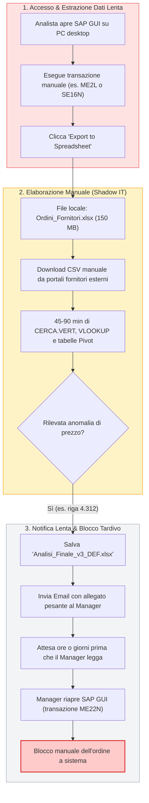
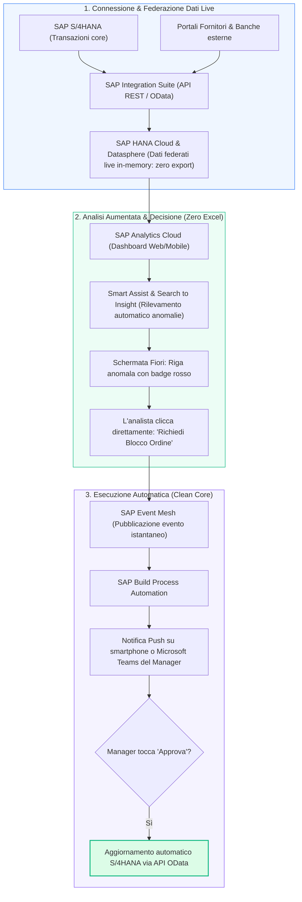

# Confronto Architetturale dei Workflow: Legacy vs SAP BTP

> **Documento di riferimento pratico per analisti, consulenti e architetti aziendali.**  
> Caso di studio: *Rilevamento anomalie di prezzo dei fornitori e autorizzazione al blocco ordini.*

---

## 1. Schema Comparativo Generale

| Parametro Chiave | Vecchio Workflow (SAP GUI + Excel) | Nuovo Workflow Moderno (SAP BTP) |
| :--- | :--- | :--- |
| **Interfaccia Utente** | SAP GUI desktop (tecnologia client anni '90) | Browser Web / Mobile responsive (**SAP Fiori / Work Zone**) |
| **Tempo di Preparazione Dati** | 1 - 3 ore di lavoro manuale a sessione | **0 secondi** (dati federati in streaming in tempo reale) |
| **Metodo di Analisi** | Formule manuali (`CERCA.VERT`, Pivot su file locali) | **Augmented Analytics** con AI integrata (**SAP Analytics Cloud**) |
| **Flusso di Comunicazione** | Email manuale con file allegati pesanti e non tracciati | **Notifiche Push istantanee** (Microsoft Teams / App Mobile) |
| **Modalità di Esecuzione** | Rientro manuale su SAP GUI per inserire blocchi | **Pulsante d'azione contestuale** collegato ad Event Mesh |
| **Integrità del Core ERP** | Rischio di personalizzazioni invasive ("oggetti Z") | **Clean Core**: ERP isolato, microservizi esterni via API |
| **Sicurezza e Conformità** | Alto rischio di data-leakage e violazioni GDPR | Dati sempre crittografati, autenticazione sicura OAuth 2.0 / IAS |

---

## 2. Il Vecchio Workflow (SAP GUI + Excel + Email)

Nel modello tradizionale, l'analista opera come un connettore umano tra sistemi disgiunti.

### Le Inefficienze Nascoste del Flusso Legacy:
1. **Costo delle Ore Lavoro (Spreco di Risorse Umane)**: Fino al 40% della giornata di un analista viene consumato in attività a zero valore aggiunto (formattazione celle, export, correzione formule corrotte).
2. **Dati Obsoleti al Momento della Decisione**: I report su Excel rappresentano una "fotografia statica"; nel tempo impiegato per analizzarli, l'ERP continua a ricevere ed evadere ordini con prezzi errati.
3. **Shadow IT & Rischio Normativo (GDPR)**: File Excel contenenti anagrafiche, condizioni commerciali riservate e importi transitano liberamente su caselle di posta e chiavette USB, esponendo l'azienda a sanzioni e fughe di dati.
4. **Debito Tecnico (ERP Spaghetto)**: Spesso, per aggirare la rigidità di SAP GUI, venivano commissionati report custom ABAP scritti direttamente nel core di produzione, rendendo gli aggiornamenti di versione quasi impossibili.

---

## 3. Il Nuovo Workflow Moderno con SAP BTP

Nel modello moderno basato su **SAP BTP**, l'elaborazione è continua, disaccoppiata e guidata dagli eventi.

### I Vantaggi Architetturali di SAP BTP:
1. **Zero Copie di Dati (Data Virtualization)**: Con **SAP HANA Cloud** e **SAP Datasphere**, i dati non vengono scaricati: rimangono protetti nel database centrale e vengono analizzati "in-place" alla velocità della memoria RAM.
2. **Actionable Insights (Dall'Analisi all'Azione)**: L'interfaccia Fiori non si limita a mostrare il dato, ma integra i comandi operativi. L'analista può agire direttamente sulla riga dell'ordine senza cambiare applicativo.
3. **Event-Driven Architecture (EDA)**: Quando l'azione viene richiesta, **SAP Event Mesh** notifica istantaneamente i sistemi destinatari in modo asincrono, evitando blocchi e garantendo resilienza anche in caso di carichi elevati.
4. **Strategia Clean Core**: Nessun programma personalizzato risiede all'interno di S/4HANA. Tutte le estensioni girano su BTP e comunicano solo tramite API standard OData/REST. Gli aggiornamenti dell'ERP avvengono senza rischi.

---

## 4. Cheat Sheet per Colloqui & Discussioni Aziendali

Se ti chiedono: *"Perché un'azienda dovrebbe investire in BTP anziché continuare con Excel e SAP GUI?"*, ecco i 3 argomenti vincenti:

1. **Ritorno sull'Investimento (ROI)**: *"L'abbonamento BTP costa una frazione rispetto a quello che l'azienda perde ogni giorno in ore lavoro sprecate in attività manuali e in perdite finanziarie dovute a fatture errate scoperte troppo tardi."*
2. **Velocità di Reazione (Real-Time Decision Making)**: *"Passiamo da un modello reattivo a posteriori (settimane dopo) a un modello proattivo in tempo reale: l'anomalia viene intercettata e bloccata prima che la merce lasci il magazzino o il pagamento sia emesso."*
3. **Agilità e Sicurezza Enterprise**: *"Eliminiamo la Shadow IT dei fogli di calcolo insicuri, garantiamo la conformità GDPR e preserviamo il Clean Core dell'ERP per aggiornamenti rapidi e continui."*
